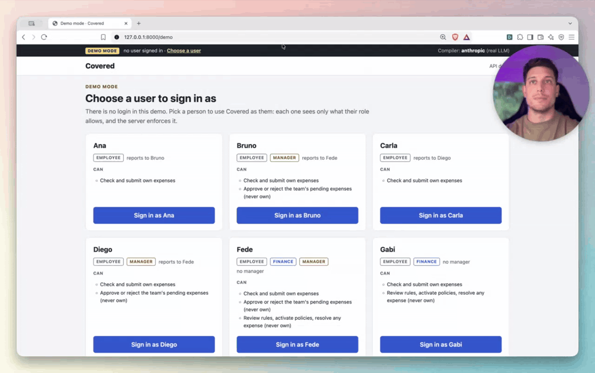

# Covered

[](https://www.loom.com/share/88e2f936963d4fdc902d2d5c475a594b)

**[Watch the video](https://www.loom.com/share/88e2f936963d4fdc902d2d5c475a594b)** (demo + code walkthrough, 6 min) · **One-page write-up:** [`docs/WRITEUP.md`](docs/WRITEUP.md)

"Will this expense be covered?" Covered turns a written expense policy into explicit rules that
finance approves, then checks every expense against them with a deterministic engine. Each outcome
quotes the policy clause behind it. An LLM is used only once per policy version, to propose rules;
checking an expense never calls it.

The contract is [`docs/SPEC.md`](docs/SPEC.md). How the code is organized, the request flows and the
design patterns it uses (with links to the code) are in [`docs/ARCHITECTURE.md`](docs/ARCHITECTURE.md).

## Quickstart

No API key is needed: without one, Covered uses a mock compiler that returns hand-written results for
the two sample policies.

```bash
uv sync
uv run covered seed     # reset ./data/covered.db: Sales + Engineering policies, 6 demo users
uv run covered serve    # http://127.0.0.1:8000
```

Then open:

- <http://127.0.0.1:8000/>: your home, or the demo panel (`/demo`) to choose who you are.
- <http://127.0.0.1:8000/employee>: check an expense ("Will this be covered?"), submit it, and see your history.
- <http://127.0.0.1:8000/team>: managers approve or reject their team's pending expenses.
- <http://127.0.0.1:8000/finance>: the policy text next to its rules, rule review, version activation and pending expenses.
- <http://127.0.0.1:8000/docs>: the JSON API (OpenAPI).

Pick who you are in the **demo panel** (`/demo`, linked from the "Demo mode" strip at the top; it
stores that user's demo token in a cookie). Each user only sees what their role allows, and the
top nav only links the pages they may open. The sample policies are in
`fixtures/policies/` and belong to a fictional company.

### Demo users, roles and tokens

There is no login: each seeded user has a fixed **demo-only** token, printed by `covered seed`.
The users come from `src/covered/store/seeds/demo.sql`, which only `covered seed` runs (it is
not a migration, so demo users never land in a real database).

| User | Roles | Policy | Manager | Token |
|---|---|---|---|---|
| `ana` | employee | Sales | `bruno` | `demo-ana` |
| `bruno` | employee, manager | Sales | `fede` | `demo-bruno` |
| `carla` | employee | Engineering | `diego` | `demo-carla` |
| `diego` | employee, manager | Engineering | `fede` | `demo-diego` |
| `fede` | employee, finance, manager | Engineering | none | `demo-fede` |
| `gabi` | employee, finance | Engineering | none | `demo-gabi` |

| Action | employee | manager | finance |
|---|---|---|---|
| Check / submit expense | own only | own only | own only |
| List / get expenses | own | own + team | all |
| Resolve pending expense | no | team members', never own | any, never own |
| Read policy / versions | own policy (active version) | own policy (active version) | all |
| Create, compile, review, classify, activate | no | no | yes |
| List employees | self | self + team | all |

The API takes `Authorization: Bearer <token>` (missing or unknown: 401). An expense you may not
see is a 404; resolving your own expense is a 403 (separation of duties). Every review,
classification, activation and resolution records who did it and when.

```bash
curl -H "Authorization: Bearer demo-bruno" http://127.0.0.1:8000/expenses   # bruno + ana
```

Requirements: [uv](https://docs.astral.sh/uv/) (it installs Python 3.13 if needed).

### With Docker (alternative)

```bash
docker build -t covered .
docker run --rm -p 8000:8000 covered                 # mock mode
docker run --rm -p 8000:8000 --env-file .env covered # real LLM, see below
```

The container seeds the demo data on start. CI builds and smoke-tests this image on every push.

## CLI

The CLI calls the same services as the API directly, not over HTTP, with the same permissions.
`--as <user>` picks the demo user: `check`/`submit` default to the `--employee`; every other
command requires `--as` (deny by default: nothing silently acts as finance). Amounts are decimals (`95.50`). A time with no UTC offset is read
in company time (America/Argentina/Buenos_Aires).

```bash
# Check only: nothing is stored
uv run covered check --employee ana --amount 95.50 --category meals --at 2026-11-22T23:30

# Submit: stores the expense; a new idempotency key is generated unless you pass --key
uv run covered submit --employee ana --amount 60 --category ground_transport --at 2026-11-03T10:00
uv run covered submit --employee ana --amount 90 --category ground_transport --key taxi-2

uv run covered policy show --as fede                 # list the policies
uv run covered policy show sales --as fede           # rules, uncompilable clauses, uncovered categories
uv run covered policy compile sales -v 2 --as fede   # compile a draft version
uv run covered policy activate sales -v 2 --as fede

uv run covered expenses list --status pending --as fede
uv run covered expenses list --as bruno            # only bruno's and his team's
uv run covered expenses resolve 2 approved --as bruno
```

Run `uv run covered --help` to see every option.

## Using a real LLM

Copy `.env.example` to `.env`, set `ANTHROPIC_API_KEY`, and export the variables before you start
the server (Covered does not read `.env` by itself):

```bash
cp .env.example .env    # then edit it
set -a; source .env; set +a
uv run covered serve
```

| Variable | Meaning |
|---|---|
| `ANTHROPIC_API_KEY` | When it is set, policies are compiled by the Anthropic API. |
| `COVERED_PROVIDER` | `mock` or `anthropic`. Default: `anthropic` if a key is set, otherwise `mock`. |
| `COVERED_MODEL` | Model used for compiling (default `claude-haiku-5-5`; `claude-sonnet-5-5` also has a known price). |
| `COVERED_DB` | SQLite file (default `./data/covered.db`). |

### Model choice

The default is `claude-haiku-5-5`; set `COVERED_MODEL=claude-sonnet-5-5` to switch.

- First real run (two sample policies, earlier prompt): Sonnet 5.5 compiled "Hotel stays ...
  up to USD X per night" as a per-expense `max_amount`, which would reject a legitimate
  3-night stay. Haiku 5.5 marked it uncompilable, the correct answer. The prompt now says
  per-unit limits are uncompilable.
- With that prompt, the [compiler eval](evals/compiler/README.md) (11 fictional policies,
  140 scored clauses per model) puts both models at about 90% accuracy: Haiku 91% with 2
  unsafe items (a missed conflict flag), Sonnet 90% with none and slightly more consistent.
  Haiku costs about USD 0.001 per policy, Sonnet about USD 0.015.

So the default rests on cost for an equal result, on a small sample. Every compiled rule is
reviewed by finance before it is active, whichever model proposed it.

`covered seed` always uses the mock, so the demo data is the same with or without a key. To
compile your own text, create a new version on the finance page (or with `POST
/policies/{id}/versions`) and compile it. The mock only knows the two sample texts.

The server writes one JSON log line per compile and per decision to stderr.
Every response has an `X-Request-ID` header (yours, if you send a valid one: 1-128 characters
from `A-Z a-z 0-9 . _ : -`), and every log line of that request carries the same
`request_id`. An unexpected error returns 500 `{"error": "internal_error", "message",
"request_id"}` and logs the stack trace. A version stuck in `compiling` for more than 5
minutes can be compiled again; the stale lock is taken over and logged.

## Ask Covered: describe an expense in your own words

On the employee page, type a sentence such as `cena con un cliente el sábado, USD 120` or
`Uber to the airport yesterday $45` and press **Interpret**. The LLM only reads the sentence into a
draft; the check form is prefilled, you review it, and the deterministic engine decides when you
press *Will this be covered?*. The LLM never decides coverage; this is the only LLM use besides
compiling policies, and checking an expense still never calls it.

```bash
curl -s -X POST http://127.0.0.1:8000/expenses/parse \
  -H "Authorization: Bearer demo-ana" -H "Content-Type: application/json" \
  -d '{"text": "cena con un cliente el sábado, USD 120"}'
# {"draft": {"category": "meals", "amount_minor": 12000, "currency": "USD",
#            "occurred_at": "2026-11-14T12:00:00-03:00", ...},
#  "missing": [], "flags": [{"code": "time_not_stated", ...}], "provider": "mock", ...}

uv run covered expenses parse "taxi ayer USD 20" --as ana
```

Code checks everything the model returns: the category must be in the catalog, the amount must be
written in the sentence (a number the model made up is dropped), only USD is accepted, relative dates
("ayer", "el viernes pasado", "last Tuesday") are resolved in code in company time, and future dates,
missing fields and two expenses in one sentence are flagged instead of guessed. Nothing is evaluated
or stored by `POST /expenses/parse`. Without an API key a small keyword/regex reader is used. With a
key the model is `COVERED_INTAKE_MODEL` (default `claude-haiku-5-5`).

Evaluation: `evals/intake/cases.yaml` has 20 hand-labeled sentences (Spanish and English); run
`uv run --with pyyaml python evals/intake/run.py --provider mock` (or `--provider anthropic --model
claude-haiku-5-5 --budget 0.05` with a key). Results are in
[`evals/intake/results/summary.md`](evals/intake/results/summary.md); the sample is small.

## Tests

```bash
uv run pytest
uv run ruff check
uv run ruff format --check
```

The tests never call the real API: they use the mock provider or a fake client.

### Compiler eval

`evals/compiler/` holds a small hand-written evaluation of the compiler (per-night limits,
amount formats, contradictions, prompt injection, a Spanish policy...) and a runner that
reports accuracy, consistency across repeats, cost and latency per model. See
[`evals/compiler/README.md`](evals/compiler/README.md) and the latest results in
`evals/compiler/results/`. It is a small sample (70 expected clauses, 11 fictional policies),
a sanity check rather than a benchmark.

## Layout

```
src/covered/
  domain/     Pydantic models, money (int minor units), categories, errors
  engine/     pure evaluation: one module per rule type, plus combine and period windows
  compiler/   output schema, providers (Anthropic, mock), deterministic validation
  store/      SQLite (stdlib sqlite3), SQL migrations, demo seed SQL, repositories
  services/   use cases and transactions; authorization (authz.py), compiler adapter, seed
  api/        FastAPI app and JSON routes
  web/        page routes, Jinja2 templates, CSS
  cli/        Typer app
fixtures/     sample policies and hand-written mock compilations
tests/        domain, engine, compiler, store, services, api, web, cli, integration
```

See [`docs/ARCHITECTURE.md`](docs/ARCHITECTURE.md) for the layer diagram and design patterns.
