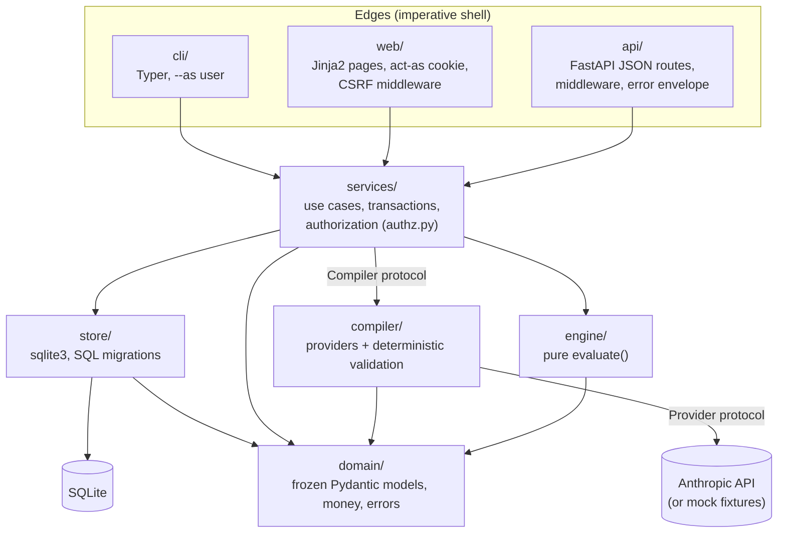
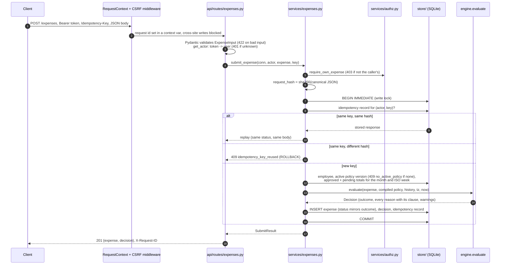
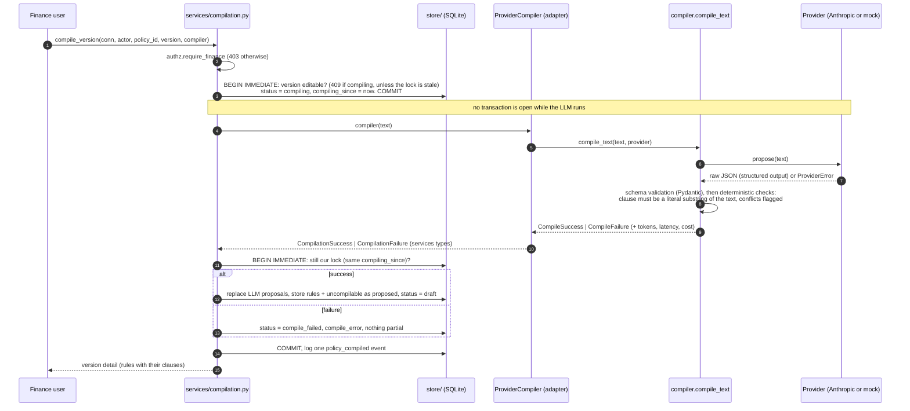

# Architecture

How Covered is put together, how a request moves through it, and which design patterns it uses
(and where). [`SPEC.md`](SPEC.md) is the contract; this document explains the code that implements
it. Line links point at `main` as of this writing; if a link drifts, the function name next to it is
the stable reference.

## 1. Layers

Rules that hold across the code base:

- **Dependencies point inward.** `domain/` imports nothing from the project. `engine/` imports
  only `domain/`. `services/` is the only layer that combines engine, store and compiler. The
  three edges (API, pages, CLI) call the same service functions, so they get the same answers and
  the same permission checks.
- **The engine never does I/O.** No database, no clock, no LLM. The caller loads the policy and
  the period history and passes in `evaluated_at`.
- **The LLM is behind two protocols** and only runs when finance compiles a policy version, never
  when an expense is checked or submitted.

| Package | Responsibility | Talks to |
|---|---|---|
| `domain/` | Value objects: money, categories, rule params, expense, decision, errors | nothing |
| `engine/` | `evaluate(expense, policy, history, tz, evaluated_at) -> Decision`, one module per rule type | `domain/` |
| `compiler/` | Output schema, `Provider` protocol, Anthropic and mock providers, deterministic validation | `domain/`, Anthropic SDK |
| `store/` | `sqlite3` connection, migrations, transactions, data-access functions | `domain/`, SQLite |
| `services/` | Use cases, transaction boundaries, authorization, compile lifecycle, seed | everything below |
| `api/`, `web/`, `cli/` | Parse input, pick the actor, call a service, render the result | `services/` |

## 2. Request flows

### 2.1 Submit an expense (`POST /expenses`)

Code path: [`routes/expenses.py` `submit_expense`](../src/covered/api/routes/expenses.py#L35-L46) ->
[`services/expenses.py` `submit_expense`](../src/covered/services/expenses.py#L73-L108) ->
[`_evaluate`](../src/covered/services/expenses.py#L181-L188) and
[`_history`](../src/covered/services/expenses.py#L191-L198) ->
[`engine/combine.py` `evaluate`](../src/covered/engine/combine.py#L35-L94).

`POST /expenses/check` runs the same evaluation in a read transaction and stores nothing
([`check_expense`](../src/covered/services/expenses.py#L58-L70)), so a check never consumes a limit.

### 2.2 Compile a policy version (`POST /policies/{id}/versions/{v}/compile`)

Finance then approves or rejects each rule, classifies each uncompilable clause, and activates the
version. Activation is refused while anything is still `proposed`, unconfirmed, or an approved rule is
flagged as a conflict ([`activate_version`](../src/covered/services/policies.py#L230-L259)).

The default real model is Haiku 5.5; Sonnet 5.5 can be selected with `COVERED_MODEL`.
<!-- TODO confirm after PR merge: default model switch to Haiku 5.5 and the compiler eval harness (path, how to run it). -->
On the sample policies, Haiku reported "USD 250.00 per night" hotel clauses as uncompilable (the
engine has no notion of nights), where Sonnet compiled them as a per-expense maximum; validation and
finance review exist precisely because both readings are plausible.

## 3. Design patterns

Each entry: what it is, where it lives, why it is there, and what it costs. Only patterns that are
actually in the code are listed.

### 3.1 Functional Core, Imperative Shell

- **Where:** [`engine/combine.py` `evaluate`](../src/covered/engine/combine.py#L35-L94) is a pure
  function; the shell that loads its inputs and stores its output is
  [`services/expenses.py` `_evaluate`](../src/covered/services/expenses.py#L181-L188) and
  [`submit_expense`](../src/covered/services/expenses.py#L73-L108). The clock is injected as
  `evaluated_at`.
- **Why:** the decision about money must be reproducible and testable without a database. Engine tests
  are plain function calls (boundaries, precedence, the period-limit example, timezone edges).
- **Trade-off:** the caller has to precompute everything the engine might need (month and week totals
  for the category) even when no `period_limit` rule applies: two small `SUM` queries per evaluation.

### 3.2 Discriminated union + exhaustive dispatch (Strategy by data)

- **Where:** [`domain/rules.py` `RuleParams`](../src/covered/domain/rules.py#L162-L169) is a Pydantic
  union discriminated by `type`; [`engine/combine.py` `_check`](../src/covered/engine/combine.py#L97-L112)
  dispatches with `match` to one module per rule type (`engine/max_amount.py`,
  `engine/period_limit.py`, ...), each exposing `check(params, expense, ...) -> Finding | None`.
- **Why:** rules are data that comes from an LLM and is stored as JSON; a closed set of variants can
  be validated, rendered as a JSON schema for structured outputs, and reviewed by a human. Each
  strategy is a small pure function. Unknown types fail loudly (`AssertionError`).
- **Trade-off:** adding a rule type touches the union, the `match`, the prompt and the UI description
  (not open/closed). Accepted: five types, and a closed set is what makes LLM output checkable.

### 3.3 Value Objects and immutability

- **Where:** every domain model is a frozen Pydantic model with `extra="forbid"`
  ([`domain/rules.py`](../src/covered/domain/rules.py#L48-L49),
  [`domain/expense.py`](../src/covered/domain/expense.py#L19),
  [`domain/decision.py`](../src/covered/domain/decision.py#L76-L92)); stored records are frozen too
  ([`store/records.py`](../src/covered/store/records.py#L56)). Money is `int` minor units, parsed from
  human input only through `Decimal` in
  [`domain/money.py` `parse_amount`](../src/covered/domain/money.py#L26-L51), which rejects floats and
  more than two decimals instead of rounding. `Reason` checks its own invariants (exactly one source)
  in [a model validator](../src/covered/domain/decision.py#L49-L63).
- **Why:** no float rounding at a limit boundary (an expense equal to the limit passes); objects
  passed into the engine cannot be mutated behind its back; invalid states fail at construction.
- **Trade-off:** one currency (USD, 2 decimals) is hard-wired; multi-currency needs a `Money(amount,
  currency)` type and per-currency minor units.

### 3.4 Ports and Adapters (hexagonal) for the LLM

- **Where:** two ports. [`compiler/result.py` `Provider`](../src/covered/compiler/result.py#L93-L100)
  (text in, raw JSON out) with adapters
  [`AnthropicProvider`](../src/covered/compiler/anthropic_provider.py#L56-L107) and
  [`MockProvider`](../src/covered/compiler/mock_provider.py#L18-L36);
  [`services/compilation.py` `Compiler`](../src/covered/services/compilation.py#L88-L89) (text in,
  services outcome out) with the adapter
  [`services/provider_compiler.py` `ProviderCompiler`](../src/covered/services/provider_compiler.py#L19-L52),
  which also translates the compiler package's types into the services' own types.
- **Why:** the compile lifecycle (lock, store, fail) does not know or care which LLM, or whether
  there is one. Tests inject a fake client (`AnthropicProvider(client=...)`) or a plain function as the
  `Compiler`, so no test calls the real API.
- **Trade-off:** two layers of result types (`CompileSuccess` and `CompilationSuccess`) plus a
  translation function: some duplication in exchange for a services layer that does not import the
  compiler package.

### 3.5 Factory and dependency injection

- **Where:** [`compiler/factory.py` `get_provider`](../src/covered/compiler/factory.py#L17-L32) picks
  mock or Anthropic from the environment;
  [`default_compiler`](../src/covered/services/provider_compiler.py#L55-L57) wraps it;
  [`api/app.py` `create_app`](../src/covered/api/app.py#L17-L39) accepts `db_path` and `compiler`
  (application factory) and FastAPI dependencies supply the connection, actor and compiler per
  request ([`api/deps.py`](../src/covered/api/deps.py#L16-L46)).
- **Why:** the demo runs with no API key (mock), tests build isolated apps on temp databases, and
  configuration lives in one place.
- **Trade-off:** configuration is read from environment variables only; there is no settings
  object or `.env` loading.

### 3.6 LLM proposes, code validates, human approves (human in the loop)

- **Where:** schema validation and deterministic checks in
  [`compiler/compile.py` `compile_text`](../src/covered/compiler/compile.py#L16-L38) and
  [`compiler/validation.py` `validate_result`](../src/covered/compiler/validation.py#L24-L61)
  (clause must be a literal substring of the policy text, otherwise the rule becomes an uncompilable
  clause; [conflicts](../src/covered/compiler/validation.py#L84-L94) are flagged). Everything is stored
  as `proposed`; [`_activation_problems`](../src/covered/services/policies.py#L262-L281) blocks
  activation until finance has reviewed it all. The structured-output schema puts `type` first
  ([`output_schema`](../src/covered/compiler/anthropic_provider.py#L34-L53)).
- **Why:** LLM output is untrusted input. A clause quote that is not in the text is a hallucination we
  can detect mechanically; what the code cannot judge (is "per night" a per-expense cap?), a person
  does. Every decision cites the approved clause.
- **Trade-off:** finance has to review every rule once per version; literal-quote matching rejects
  harmless paraphrases (they reappear as uncompilable clauses for finance to handle).

### 3.7 Layered architecture with a service layer

- **Where:** see section 1. All use cases live in `services/`
  ([`expenses.py`](../src/covered/services/expenses.py),
  [`policies.py`](../src/covered/services/policies.py),
  [`compilation.py`](../src/covered/services/compilation.py)); the API routes, pages and CLI are thin.
- **Why:** three front ends with one behavior; authorization cannot be skipped by calling a
  different edge.
- **Trade-off:** services take a `sqlite3.Connection` and open transactions themselves, so they are
  coupled to the DB-API connection type (not to SQLite SQL, which stays in `store/`).

### 3.8 Data-access modules (repository-style, without an interface)

- **Where:** `store/expenses.py`, `store/policies.py`, `store/rules.py`, `store/employees.py`,
  `store/idempotency.py`: plain functions that take a connection, run SQL and return frozen records
  (e.g. [`period_totals`](../src/covered/store/expenses.py#L81-L98)). Schema changes are numbered SQL
  files applied by [`migrate`](../src/covered/store/db.py#L47-L72).
- **Why:** all SQL in one package; services read like the use case, not like SQL.
- **Trade-off:** the docstrings say "repository", but there is no abstract repository interface or
  in-memory implementation; this is closer to Fowler's Table Data Gateway. Moving to Postgres means
  rewriting `store/` (SQL dialect, locking), not the engine or the services' logic.

### 3.9 Transaction Script with explicit transaction boundaries (`BEGIN IMMEDIATE`)

- **Where:** [`store/db.py` `transaction`](../src/covered/store/db.py#L89-L100) (autocommit off,
  explicit `BEGIN`/`COMMIT`/`ROLLBACK`); each use case opens one transaction, e.g.
  [`submit_expense`](../src/covered/services/expenses.py#L86-L106) and
  [`resolve_expense`](../src/covered/services/expenses.py#L155-L165) with `immediate=True`.
- **Why:** read totals, evaluate and insert must be atomic, or two concurrent submits could both use
  the same remaining monthly limit. `BEGIN IMMEDIATE` takes SQLite's write lock before the read.
- **Trade-off:** SQLite has one writer, so all writes serialize, across all employees. With Postgres
  this becomes a per-employee-and-category lock (`SELECT ... FOR UPDATE` or an advisory lock). It is
  not a Unit of Work in Fowler's sense (no change tracking); the transaction is the unit.

### 3.10 Idempotency Key

- **Where:** [`services/expenses.py` `submit_expense`](../src/covered/services/expenses.py#L82-L106),
  [`fingerprint`](../src/covered/services/expenses.py#L175-L178),
  [`store/idempotency.py`](../src/covered/store/idempotency.py); the employee page puts a fresh key in
  a hidden field, so a browser re-post is a replay.
- **Why:** a retried submit (network timeout, double click) must not create a second expense or
  consume the limit twice. Keys are scoped per user (primary key `(actor_id, key)`), so two users
  never collide. Same key and same body returns the stored response; same key and a
  different body is 409. The check and the insert are in the same transaction, so two concurrent
  retries cannot both pass.
- **Trade-off:** keys never expire (no cleanup job), and the hash is over the validated request, so
  two bodies that differ only in formatting count as the same request (intended).

### 3.11 Deny-by-default, centralized authorization (BOLA returns 404)

- **Where:** [`services/authz.py`](../src/covered/services/authz.py) holds every rule; services call
  it before touching data. Hidden objects are 404, not 403:
  [`_visible_expense`](../src/covered/services/expenses.py#L211-L218) and
  [`get_version_detail`](../src/covered/services/policies.py#L123-L131). Separation of duties:
  [`require_can_resolve`](../src/covered/services/authz.py#L40-L48). Unknown token is 401
  ([`api/deps.py` `get_actor`](../src/covered/api/deps.py#L32-L37)); the CLI requires `--as` for
  every finance-capable command.
- **Why:** broken object-level authorization is the top OWASP API risk; checking the specific
  resource (not just the role) in the service layer protects the API, pages and CLI equally.
- **Trade-off:** identity is a fixed demo token per user (no login, no expiry); the permission
  matrix is code, not data.

### 3.12 Middleware chain (request id, CSRF, catch-all 500)

- **Where:** [`api/app.py`](../src/covered/api/app.py#L33-L34) adds
  [`CsrfMiddleware`](../src/covered/web/csrf.py#L25-L60) and
  [`RequestContextMiddleware`](../src/covered/api/request_context.py#L34-L74) (outermost, so even a
  CSRF rejection carries an `X-Request-ID`). The request id lives in a `ContextVar` that
  [`log_event`](../src/covered/services/events.py#L18-L23) adds to every log line.
- **Why:** cross-cutting concerns stay out of the routes. The 500 handler is a middleware because
  Starlette runs `exception_handler(Exception)` outside the middleware stack, where the request id is
  gone.
- **Trade-off:** raw ASGI middlewares are more verbose than decorators; CSRF relies on Fetch Metadata
  and `Origin`, plus a `SameSite=Lax` cookie, rather than synchronizer tokens.

### 3.13 Error codes translated at the edge

- **Where:** every expected error is a [`CoveredError`](../src/covered/domain/errors.py#L8-L15)
  subclass with a stable `code`; [`api/errors.py`](../src/covered/api/errors.py#L11-L48) maps codes to
  HTTP statuses (default 409) and the `{error, message}` envelope; the CLI prints `code: message`.
- **Why:** services do not know about HTTP; one mapping table instead of status codes scattered in
  routes.
- **Trade-off:** "anything else is 409" is a convention a new error class must respect.

### 3.14 State machines guarded in the service layer

- **Where:** statuses are enums in [`store/records.py`](../src/covered/store/records.py#L16-L50).
  Policy version: `draft -> compiling -> draft | compile_failed -> active -> retired`, guarded by
  [`require_editable`](../src/covered/services/policies.py#L339-L352) (active and retired are
  immutable) and [`activate_version`](../src/covered/services/policies.py#L230-L259); the database
  enforces at most one active version per policy (partial unique index in
  [`001_initial.sql`](../src/covered/store/migrations/001_initial.sql#L23)). Expense:
  `approved | pending | rejected`, and only `pending -> approved | rejected` through
  [`resolve_expense`](../src/covered/services/expenses.py#L143-L172) (409 otherwise).
- **Why:** immutable active versions make every stored decision reproducible: it records the policy
  id and version that produced it.
- **Trade-off:** transitions are guard clauses spread over a few functions, not an explicit
  transition table; fine for two small lifecycles.

### 3.15 Lease lock with stale takeover and a fencing check (compile lock)

- **Where:** [`services/compilation.py`](../src/covered/services/compilation.py#L130-L173):
  `_acquire_lock` sets `compiling` and `compiling_since`; `_is_stale` treats a lock older than
  [`STALE_LOCK_AFTER`](../src/covered/services/compilation.py#L80-L81) (5 minutes) as abandoned and
  takes it over (logged); before storing, `_require_lock` checks that `compiling_since` is still ours,
  so a slow compile whose lock was taken over stores nothing.
- **Why:** the LLM call takes seconds and must not hold a database transaction; a crashed process
  must not leave a version stuck in `compiling` forever. 5 minutes is the provider's worst case
  (60 s timeout x 4 attempts) plus a margin.
- **Trade-off:** depends on wall-clock time; a compile slower than 5 minutes would be overtaken
  (it then discards its own result rather than overwrite the newer one).

### 3.16 Audit trail (who, when, which version)

- **Where:** audit columns `reviewed_by/at`, `classified_by/at`, `activated_by/at`, `resolved_by/at`
  ([`002_roles_and_audit.sql`](../src/covered/store/migrations/002_roles_and_audit.sql#L13-L23), no
  foreign key on purpose); each submitted expense stores its full decision with policy id and version
  ([`insert_decision`](../src/covered/store/expenses.py#L101-L116)); one structured JSON log event per
  compile and per decision ([`services/events.py`](../src/covered/services/events.py)).
- **Why:** finance needs to answer "who approved this and under which rules?" months later.
- **Trade-off:** the columns record the last action, not a full history (a rule edited twice keeps
  only the last reviewer); an append-only event table would be the next step.

### 3.17 Post/Redirect/Get on the pages

- **Where:** finance and resolve forms redirect with 303 after a write
  ([`web/pages.py` `_back`](../src/covered/web/pages.py#L314-L316)); the employee form renders its
  decision directly and relies on the idempotency key instead.
- **Why:** a browser refresh must not repeat an approval or a compile.
- **Trade-off:** messages travel in the query string.

## 4. What is deliberately not here

- No ORM, no message queue, no background worker: compiling is synchronous and takes seconds.
- No caching: each evaluation reads the active version and two period totals from SQLite.
- No plugin system for rule types: the closed set is a feature (see 3.2).
